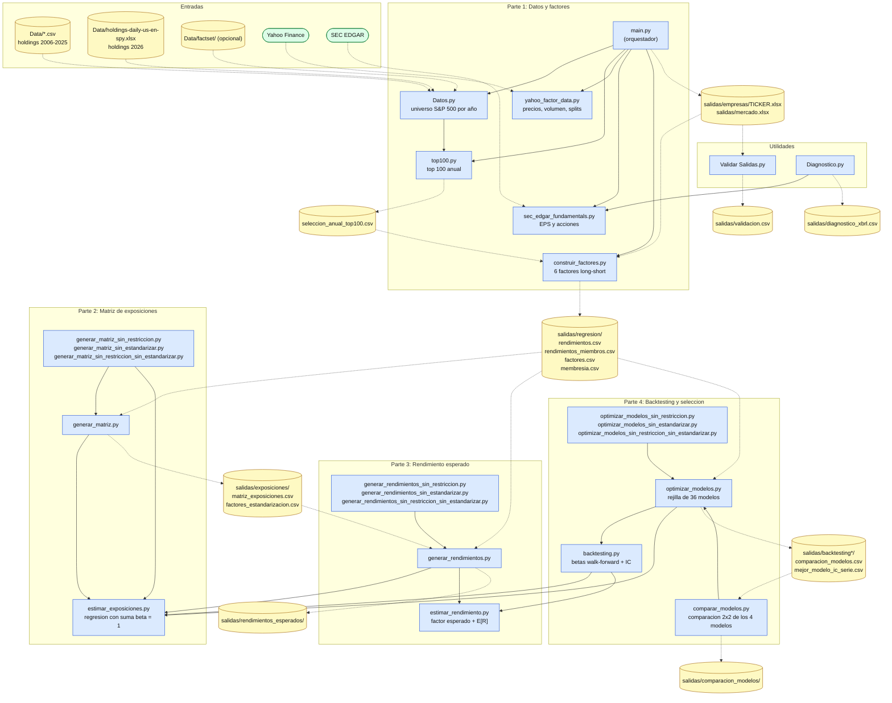

# PAP_IPEJAL_2: modelo de factores para el Top 100 del S&P 500

Pipeline que arma un universo histórico del S&P 500, descarga precios y fundamentales, construye factores tipo Fama-French, estima la exposición (beta) de cada acción a esos factores, calcula un rendimiento esperado mensual por acción y evalúa el modelo con un backtest walk-forward medido con el Coeficiente de Información (IC).

El proyecto se divide en 4 partes que se corren **en orden**, porque cada una consume las salidas de la anterior:

| Parte | Qué hace | Script principal |
|---|---|---|
| 1. Datos y factores | Universo S&P 500, top 100 anual, precios, fundamentales y factores | `main.py` |
| 2. Matriz de exposiciones | Beta de cada acción a cada factor (con restricción ∑β = 1) | `generar_matriz.py` |
| 3. Rendimiento esperado | E[R] mensual de cada acción a partir de los betas | `generar_rendimientos.py` |
| 4. Backtesting y selección | Betas walk-forward, IC y búsqueda en rejilla del mejor modelo | `optimizar_modelos.py` |

---

## 1. Diagrama de conexiones entre archivos

Las flechas continuas (`-->`) son `import` entre scripts. Las flechas punteadas (`-.->`) son archivos de datos que se leen o se escriben. Las variantes `sin_restriccion` y `sin_estandarizar` van agrupadas en un solo nodo por etapa.



| Color | Significado |
|---|---|
| Azul | Scripts `.py` |
| Amarillo | Archivos de datos (entradas y salidas) |
| Verde | Fuentes externas (Yahoo Finance, SEC EDGAR) |

---

## 2. Requirements

Crea un entorno virtual e instala dependencias:

```bash
python -m venv venv
source venv/bin/activate        # Windows: venv\Scripts\activate
pip install -r requirements.txt
pip install scipy               # necesario para la Parte 4 (IC de Spearman)
pip install matplotlib          # opcional: gráfico de comparar_modelos.py
```

Python 3.10+ (el código usa type hints como `list[str] | None`).

### Configuración antes de correr

Abre **`sec_edgar_fundamentals.py`** y cambia la línea `USER_AGENT` por tu nombre y correo real. SEC EDGAR exige un `User-Agent` identificable:

```python
USER_AGENT = "Tu Nombre tu_correo@ejemplo.com"
```

> El script solo falla a propósito si el `User-Agent` contiene el texto placeholder `tu_correo@ejemplo.com`. Cualquier otro valor se envía tal cual, así que usa un correo que sea tuyo.

---

## 3. Estructura de carpetas

```
PAP_IPEJAL_2/
├── Data/                              insumos crudos (solo lectura)
│   ├── 2006.csv ... 2025.csv          holdings anuales del S&P 500
│   ├── holdings-daily-us-en-spy.xlsx  holdings 2026
│   └── factset/                       (opcional) SP500_AAAA.xlsx de FactSet Screening
│
├── Parte 1: datos y factores
│   ├── main.py                        orquesta toda la Parte 1
│   ├── Datos.py                       universo S&P 500 histórico
│   ├── top100.py                      top 100 por market cap de cada año
│   ├── yahoo_factor_data.py           precios, volumen, splits, S&P 500 y T-bill
│   ├── sec_edgar_fundamentals.py      EPS y acciones en circulación (SEC EDGAR)
│   └── construir_factores.py          factores mensuales
│
├── Parte 2: matriz de exposiciones
│   ├── estimar_exposiciones.py        regresión con restricción
│   └── generar_matriz.py              orquesta la Parte 2
│
├── Parte 3: rendimiento esperado
│   ├── estimar_rendimiento.py         factor esperado + rendimiento esperado
│   └── generar_rendimientos.py        orquesta la Parte 3
│
├── Parte 4: backtesting y selección
│   ├── backtesting.py                 betas walk-forward, rendimiento esperado e IC
│   ├── optimizar_modelos.py           búsqueda en rejilla del mejor modelo
│   └── comparar_modelos.py            comparación de los 4 modelos (diseño 2x2)
│
├── Variantes (modelos 2, 3 y 4)
│   ├── generar_matriz_sin_restriccion.py
│   ├── generar_matriz_sin_estandarizar.py
│   ├── generar_matriz_sin_restriccion_sin_estandarizar.py
│   ├── generar_rendimientos_sin_restriccion.py
│   ├── generar_rendimientos_sin_estandarizar.py
│   ├── generar_rendimientos_sin_restriccion_sin_estandarizar.py
│   ├── optimizar_modelos_sin_restriccion.py
│   ├── optimizar_modelos_sin_estandarizar.py
│   └── optimizar_modelos_sin_restriccion_sin_estandarizar.py
│
├── Utilidades
│   ├── Validar Salidas.py             detecta datos sospechosos en salidas/empresas
│   └── Diagnostico.py                 qué tags XBRL trae la SEC para un ticker
│
├── seleccion_anual_top100.csv         top 100 por año (salida de top100.py)
├── revision_top100_anual.csv          estado de cada empresa-año (OK, MANUAL, REVISAR...)
├── universo_sp500_completo.csv        universo completo por año
├── universo_final_top100_global.csv   (universo de referencia)
├── universo_sp500.csv                 (universo de referencia)
├── requirements.txt
└── salidas/                           TODAS las salidas del pipeline (se crea sola)
    ├── empresas/<TICKER>.xlsx             precios, EPS, acciones e info (Parte 1)
    ├── empresas_anteriores/               tickers que salieron del universo
    ├── mercado.xlsx
    ├── reporte_errores.csv
    ├── reporte_cobertura_edgar.csv
    ├── resumen_universo.xlsx
    ├── revision_precios_vs_top100.csv
    ├── validacion.csv                     (Validar Salidas.py)
    ├── regresion/                         salidas de la Parte 1 que usan las Partes 2 a 4
    │   ├── rendimientos.csv                   fecha x ticker, todas las empresas
    │   ├── rendimientos_miembros.csv          fecha x ticker, solo meses en el top 100
    │   ├── membresia.csv                      fecha x ticker, 1/0
    │   ├── factores.csv                       rf, MERCADO, VALUE, TAMANO, MOMENTUM, VOLATILIDAD, LIQUIDEZ
    │   ├── caracteristicas.csv
    │   └── insumos_regresion.xlsx
    ├── exposiciones/                      Parte 2
    │   ├── matriz_exposiciones.csv/.xlsx      alpha, beta por factor, r2, n_obs, suma_beta
    │   └── factores_estandarizacion.csv       media y desviación de cada factor
    ├── rendimientos_esperados/            Parte 3
    │   ├── rendimientos_esperados_ventana{3,6,12}.csv
    │   └── rendimientos_esperados.xlsx
    ├── backtesting/                       Parte 4
    │   ├── comparacion_modelos.csv/.xlsx
    │   ├── mejor_modelo_ic_serie.csv
    │   ├── mejor_modelo_rendimiento_esperado.csv
    │   └── mejor_modelo_exposiciones/
    ├── backtesting_sin_restriccion/       Modelo 2 (misma estructura)
    ├── backtesting_sin_estandarizar/      Modelo 3 (misma estructura)
    ├── backtesting_sin_restriccion_sin_estandarizar/   Modelo 4 (misma estructura)
    └── comparacion_modelos/               salida de comparar_modelos.py
```

`Data/` nunca se escribe: es solo de entrada. Todo lo que el pipeline produce vive en `salidas/` (más los CSV de selección en la raíz).

**Importante:** todos los scripts usan rutas **relativas** (`Path("salidas/...")`), así que **siempre corre los scripts parado en la raíz del repo** (`PAP_IPEJAL_2/`), nunca desde otra carpeta.

---

## 4. Orden de ejecución, desde cero

```bash
cd PAP_IPEJAL_2

# Parte 1: universo, precios, fundamentales y factores
python main.py

# Parte 2: matriz de exposiciones (betas)
python generar_matriz.py

# Parte 3: rendimiento esperado por acción
python generar_rendimientos.py

# Parte 4: backtesting y selección del mejor modelo
python optimizar_modelos.py
```

Para el diseño 2x2 (modelos 2, 3 y 4) y su comparación:

```bash
# Modelo 2: sin restricción sum(beta)=1
python generar_matriz_sin_restriccion.py
python generar_rendimientos_sin_restriccion.py
python optimizar_modelos_sin_restriccion.py

# Modelo 3: sin estandarizar
python generar_matriz_sin_estandarizar.py
python generar_rendimientos_sin_estandarizar.py
python optimizar_modelos_sin_estandarizar.py

# Modelo 4: sin restricción y sin estandarizar
python generar_matriz_sin_restriccion_sin_estandarizar.py
python generar_rendimientos_sin_restriccion_sin_estandarizar.py
python optimizar_modelos_sin_restriccion_sin_estandarizar.py

# Comparación de los 4 modelos
python comparar_modelos.py
```

Utilidades (opcionales):

```bash
python "Validar Salidas.py"            # revisa salidas/empresas y escribe salidas/validacion.csv
python Diagnostico.py BRK.B V          # tags XBRL de la SEC para esos tickers
```

Cada script imprime en consola un resumen de lo que hizo y avisos de cobertura y calidad (empresas sin datos suficientes, R² bajo, etc.). Vale la pena leer la terminal, no solo abrir los archivos.

---

## 5. Qué hace cada parte, a detalle

### Parte 1: `main.py`

1. Construye el universo S&P 500 por año combinando los CSV de `Data/`, el Excel de holdings 2026 y, si existen, las exportaciones de FactSet (`Datos.py`).
2. Selecciona el Top 100 por market cap de cada año desde 2010 (`top100.py`). Una tabla de equivalencias manuales resuelve empresas renombradas, compradas o con tickers reasignados.
3. Descarga precios y volumen (`yahoo_factor_data.py`) y EPS y acciones en circulación vía SEC EDGAR (`sec_edgar_fundamentals.py`). Los EPS más recientes que la SEC aún no publica se completan con Yahoo.
4. Guarda un Excel por empresa en `salidas/empresas/`.
5. Revisa la cobertura de precios contra el año de entrada al top 100.
6. Construye los factores mensuales (`construir_factores.py`) hacia `salidas/regresion/`.

**Factores** (portafolios largo-corto al 30%, con ordenamiento en t-1 y rendimiento en t, sin look-ahead):

| Factor | Definición |
|---|---|
| MERCADO | Rendimiento del S&P 500 (`^GSPC`) menos rf |
| VALUE | P/E bajo menos P/E alto (solo EPS TTM > 0) |
| TAMANO | Market cap chico menos grande |
| MOMENTUM | Rendimiento t-12..t-2 alto menos bajo |
| VOLATILIDAD | Volatilidad de 12 meses baja menos alta |
| LIQUIDEZ | Rotación de 3 meses baja menos alta (ortogonalizada contra VOLATILIDAD) |

### Parte 2: `generar_matriz.py` (usa `estimar_exposiciones.py`)

Para cada acción, regresión de su rendimiento en exceso de `rf` contra los 6 factores, con la restricción ∑β = 1 impuesta de forma exacta: se despeja el beta de un factor base (MERCADO) y se sustituye en la ecuación, sin optimización numérica. Los factores se estandarizan una sola vez con la media y desviación de toda su serie, y esos valores se guardan en `factores_estandarizacion.csv` para que la Parte 3 use la misma escala. Guarda `matriz_exposiciones.csv/.xlsx` con alpha, un beta por factor, R², n_obs y la suma de betas (para validar la restricción).

### Parte 3: `generar_rendimientos.py` (usa `estimar_rendimiento.py`)

Para cada factor ya estandarizado, calcula un rendimiento esperado mensual: rolling mean de los últimos 3, 6 o 12 meses, rezagado 1 mes para no ver el futuro. Luego, para cada acción:

```
E[R_i,t] = Σ_k  beta_i,k · factor_esperado_k,t
```

usando el beta fijo de la Parte 2 y el factor esperado (que sí varía mes a mes). Guarda un CSV por ventana más un Excel resumen con la cobertura de cada una.

### Parte 4: `optimizar_modelos.py` (usa `backtesting.py`)

- **Betas walk-forward:** en cada fecha de corte los betas se reestiman usando solo datos hasta ese corte, con ventana expansiva (`None`) o móvil (36, 60 o 120 meses). Los factores se estandarizan con la media y desviación de ese mismo corte.
- **Rendimiento esperado:** para cada mes se usa el beta del corte más reciente anterior y el factor esperado construido con la misma estandarización.
- **IC:** correlación de Spearman mensual entre el rendimiento esperado y el real, medida solo con las empresas del Top 100 de ese mes. Se resume con IC medio, IC std, IC Ratio, t-stat y hit rate.
- **Rejilla:** 4 ventanas de beta × 3 mínimos de observaciones × 3 ventanas de factor = 36 modelos, todos evaluados en las mismas fechas.

### Diseño 2x2 (`comparar_modelos.py`)

| Modelo | Factores | Betas |
|---|---|---|
| 1 (base) | Estandarizados | ∑β = 1 |
| 2 | Estandarizados | Libres |
| 3 | Sin estandarizar | ∑β = 1 |
| 4 | Sin estandarizar | Libres |

`comparar_modelos.py` no recalcula nada: lee las salidas de cada `optimizar_modelos*.py` y compara (A) el ganador de cada modelo, (B) los ganadores en las mismas fechas con prueba pareada, (C) la misma configuración en los 4 modelos y (D) los efectos principales del 2x2.

---

## 6. Parámetros que puedes ajustar

Todos están al inicio de cada script:

| Script | Parámetros |
|---|---|
| `main.py` | `TOP_N`, `ANIO_INICIO` |
| `construir_factores.py` | `CORTE`, `MIN_EMPRESAS`, `PONDERACION`, `MESES_MOMENTUM`, `MESES_VOL`, `ORTOGONALIZAR`, `UMBRAL_CORRELACION` |
| `generar_matriz.py` | `FACTORES`, `FACTOR_BASE`, `RESTRINGIR_SUMA`, `MIN_OBS`, `VENTANA_MESES`, `R2_AVISO`, `ESTANDARIZAR`, `ESTANDARIZAR_Y`, `ENTRENAR_CON_HISTORIAL` |
| `generar_rendimientos.py` | `VENTANAS`, `REZAGO_MESES`, `INCLUIR_ALPHA` |
| `optimizar_modelos.py` | `VENTANAS_BETA`, `MIN_OBS_GRID`, `VENTANAS_FACTOR`, `FRECUENCIA_REESTIMACION`, `REZAGO_FACTOR`, `MIN_ACCIONES_IC`, `MIN_PERIODOS`, `ESTANDARIZAR`, `ESTANDARIZAR_Y`, `ENTRENAR_CON_HISTORIAL` |

---

## 7. Notas y limitaciones conocidas

- Empresas que estuvieron muy pocos meses en el top 100 quedan con `n_obs` bajo en la Parte 2 y, por lo tanto, con `NaN` en la Parte 3.
- Las empresas compradas o desaparecidas (marcadas `None` en `EQUIVALENCIAS_MANUALES` de `top100.py`) cuentan en el top 100 de su época, pero no tienen precios en Yahoo. Esto introduce cierto sesgo de supervivencia y deja menos de 100 empresas con datos en los primeros años.
- Los datos XBRL de la SEC existen desde ~2009-2011, así que 2006-2009 queda vacío en P/E y market cap.
- El factor MERCADO usa el índice de precio del S&P 500 (sin dividendos), mientras que los rendimientos de las acciones incluyen dividendos.
- La ortogonalización de LIQUIDEZ contra VOLATILIDAD usa la pendiente de toda la muestra, lo que introduce un look-ahead leve en ese factor.
- SEC EDGAR tiene límite de tasa: `sec_edgar_fundamentals.py` ya mete pausas (`time.sleep`) entre requests. No lo corras en paralelo ni bajes la pausa, o te bloquearán el `User-Agent`.
- Quedarse con el mejor de 36 configuraciones infla el resultado (sesgo de selección). Por eso `comparar_modelos.py` incluye el promedio de la rejilla como comparación más honesta.