# PAP_IPEJAL_2: modelo de factores para el Top 100 del S&P 500

Pipeline que arma un universo histórico del S&P 500, descarga precios y fundamentales, construye factores tipo Fama-French, estima la exposición (beta) de cada acción a esos factores, calcula un rendimiento esperado mensual por acción y evalúa el modelo con un backtest walk-forward medido con el Coeficiente de Información (IC). Después calibra el modelo, arma con él una estrategia largo-corto, la compara contra dos estrategias pasivas, prueba su sensibilidad y atribuye su rendimiento por sector (Brinson-Hood-Beebower).

El proyecto se divide en 5 partes que se corren **en orden**, porque cada una consume las salidas de la anterior:

| Parte | Qué hace | Script principal |
|---|---|---|
| 1. Datos y factores | Universo S&P 500, top 100 anual, precios, fundamentales y factores | `main.py` |
| 2. Matriz de exposiciones | Beta de cada acción a cada factor (con restricción ∑β = 1) | `generar_matriz.py` |
| 3. Rendimiento esperado | E[R] mensual de cada acción a partir de los betas | `generar_rendimientos.py` |
| 4. Backtesting y selección | Betas walk-forward, IC y búsqueda en rejilla del mejor modelo | `optimizar_modelos.py` |
| 5. Calibración, estrategia, sensibilidad y atribución | Modelo final, portafolio largo-corto, robustez y atribución por sector | `calibrar_modelos.py`, `estrategia_cuantilica.py`, `analisis_sensibilidad.py`, `atribucion_bhb.py` |

> **Numeración:** las "Partes" de este README son etapas del código y no coinciden con las partes de la entrega del curso (donde la "Parte 4" es el reporte escrito). La sección 7 indica qué archivos alimentan cada punto del reporte.

---

## 1. Diagrama de conexiones entre archivos

Las flechas continuas (`-->`) son `import` entre scripts. Las flechas punteadas (`-.->`) son archivos de datos que se leen o se escriben. Las variantes `sin_restriccion` y `sin_estandarizar` van agrupadas en un solo nodo por etapa. El mismo diagrama está en `diagrama_pipeline.md`.

```mermaid
flowchart TD

    %% ===== ENTRADAS =====
    subgraph ENTRADAS["Entradas"]
        D1[("Data/*.csv<br/>holdings 2006-2025")]
        D2[("Data/holdings-daily-us-en-spy.xlsx<br/>holdings 2026")]
        D3[("Data/factset/ (opcional)")]
        EXT1(["Yahoo Finance"])
        EXT2(["SEC EDGAR"])
    end

    %% ===== PARTE 1 =====
    subgraph P1["Parte 1: Datos y factores"]
        MAIN["main.py<br/>(orquestador)"]
        DATOS["Datos.py<br/>universo S&P 500 por año"]
        TOP["top100.py<br/>top 100 anual"]
        YAH["yahoo_factor_data.py<br/>precios, volumen, splits"]
        SEC["sec_edgar_fundamentals.py<br/>EPS y acciones"]
        FAC["construir_factores.py<br/>6 factores long-short"]
    end

    D1 -.-> DATOS
    D2 -.-> DATOS
    D3 -.-> DATOS
    EXT1 -.-> YAH
    EXT2 -.-> SEC

    MAIN --> DATOS
    MAIN --> TOP
    MAIN --> YAH
    MAIN --> SEC
    MAIN --> FAC
    DATOS --> TOP

    TOP -.-> SEL[("seleccion_anual_top100.csv")]
    MAIN -.-> EMP[("salidas/empresas/TICKER.xlsx<br/>salidas/mercado.xlsx")]
    SEL -.-> FAC
    EMP -.-> FAC
    FAC -.-> REG[("salidas/regresion/<br/>rendimientos.csv<br/>rendimientos_miembros.csv<br/>factores.csv<br/>membresia.csv")]

    %% ===== PARTE 2 =====
    subgraph P2["Parte 2: Matriz de exposiciones"]
        EXPO["estimar_exposiciones.py<br/>regresion con suma beta = 1"]
        GMAT["generar_matriz.py"]
        GMATV["generar_matriz_sin_restriccion.py<br/>generar_matriz_sin_estandarizar.py<br/>generar_matriz_sin_restriccion_sin_estandarizar.py"]
    end

    REG -.-> GMAT
    GMAT --> EXPO
    GMATV --> GMAT
    GMATV --> EXPO
    GMAT -.-> MEXP[("salidas/exposiciones/<br/>matriz_exposiciones.csv<br/>factores_estandarizacion.csv")]

    %% ===== PARTE 3 =====
    subgraph P3["Parte 3: Rendimiento esperado"]
        ERES["estimar_rendimiento.py<br/>factor esperado + E[R]"]
        GREN["generar_rendimientos.py"]
        GRENV["generar_rendimientos_sin_restriccion.py<br/>generar_rendimientos_sin_estandarizar.py<br/>generar_rendimientos_sin_restriccion_sin_estandarizar.py"]
    end

    MEXP -.-> GREN
    REG -.-> GREN
    GREN --> EXPO
    GREN --> ERES
    GRENV --> GREN
    GREN -.-> RESP[("salidas/rendimientos_esperados/")]

    %% ===== PARTE 4 =====
    subgraph P4["Parte 4: Backtesting y seleccion"]
        BACK["backtesting.py<br/>betas walk-forward + IC"]
        OPT["optimizar_modelos.py<br/>rejilla de 36 modelos"]
        OPTV["optimizar_modelos_sin_restriccion.py<br/>optimizar_modelos_sin_estandarizar.py<br/>optimizar_modelos_sin_restriccion_sin_estandarizar.py"]
        COMP["comparar_modelos.py<br/>comparacion 2x2 de los 4 modelos"]
    end

    REG -.-> OPT
    OPT --> BACK
    OPT --> EXPO
    BACK --> EXPO
    BACK --> ERES
    OPTV --> OPT
    OPT -.-> BT[("salidas/backtesting*/<br/>comparacion_modelos.csv<br/>mejor_modelo_ic_serie.csv")]
    BT -.-> COMP
    COMP --> OPT
    COMP -.-> CMP[("salidas/comparacion_modelos/")]

    %% ===== PARTE 5 =====
    subgraph P5["Parte 5: Calibracion, estrategia, sensibilidad y atribucion"]
        CAL["calibrar_modelos.py<br/>versiones A, B y C de los 4 modelos"]
        AJ["ajustes.py<br/>pesos por IC (B) y shrinkage (C)"]
        BAJ["backtesting_ajustado.py<br/>insumos, IC por factor, shrinkage"]
        EST["estrategia_cuantilica.py<br/>largo-corto top N / bottom N"]
        MET["metricas_desempeno.py<br/>Sharpe, Sortino, CAPM, drawdown"]
        SENS["analisis_sensibilidad.py<br/>ventana de betas x rebalanceo"]
        SECS["descargar_sectores.py<br/>sector de cada empresa"]
        BHB["atribucion_bhb.py<br/>Brinson-Hood-Beebower por pierna"]
    end

    BT -.-> CAL
    REG -.-> CAL
    CAL --> OPT
    CAL --> BACK
    CAL --> EXPO
    CAL --> AJ
    CAL --> BAJ
    BAJ --> AJ
    BAJ --> BACK
    BAJ --> EXPO
    AJ --> EXPO
    CAL -.-> CALD[("salidas/calibracion/<br/>finalistas_12_mismas_fechas.csv<br/>modeloN/")]

    CALD -.-> EST
    REG -.-> EST
    EST --> OPT
    EST --> MET
    EST -.-> ESTD[("salidas/estrategia/<br/>modeloN_X_mejor_global/")]

    CALD -.-> SENS
    REG -.-> SENS
    SENS --> CAL
    SENS --> EST
    SENS --> MET
    SENS --> OPT
    SENS --> BACK
    SENS --> AJ
    SENS --> BAJ
    SENS -.-> SEND[("salidas/sensibilidad/")]

    EMP -.-> SECS
    EXT1 -.-> SECS
    SECS -.-> SECD[("salidas/sectores/sectores.csv")]

    ESTD -.-> BHB
    CALD -.-> BHB
    REG -.-> BHB
    SECD -.-> BHB
    BHB --> OPT
    BHB --> MET
    BHB -.-> BHBD[("salidas/atribucion_bhb/")]

    %% ===== UTILIDADES =====
    subgraph UTIL["Utilidades"]
        VAL["Validar Salidas.py"]
        DIAG["Diagnostico.py"]
        REVC["revisar_cobertura_minobs.py"]
        RANK["ranking_prueba.py"]
        PR2["prueba_r2.py"]
    end

    EMP -.-> VAL
    VAL -.-> VCSV[("salidas/validacion.csv")]
    DIAG --> SEC
    DIAG -.-> DCSV[("salidas/diagnostico_xbrl.csv")]
    REG -.-> REVC
    REVC --> BACK
    REVC --> EXPO
    REG -.-> PR2
    PR2 --> EXPO
    ESTD -.-> RANK
    D1 -.-> RANK
    REVC -.-> COBD[("salidas/cobertura/")]
    RANK -.-> RANKD[("salidas/ranking_marketcap/")]

    %% ===== ESTILOS =====
    classDef script fill:#dbeafe,stroke:#1d4ed8,color:#111;
    classDef datos fill:#fef9c3,stroke:#a16207,color:#111;
    classDef externo fill:#dcfce7,stroke:#15803d,color:#111;

    class MAIN,DATOS,TOP,YAH,SEC,FAC,EXPO,GMAT,GMATV,ERES,GREN,GRENV,BACK,OPT,OPTV,COMP,CAL,AJ,BAJ,EST,MET,SENS,SECS,BHB,VAL,DIAG,REVC,RANK,PR2 script;
    class D1,D2,D3,SEL,EMP,REG,MEXP,RESP,BT,CMP,CALD,ESTD,SEND,SECD,BHBD,VCSV,DCSV,COBD,RANKD datos;
    class EXT1,EXT2 externo;
```



| Color | Significado |
|---|---|
| Azul | Scripts `.py` |
| Amarillo | Archivos de datos (entradas y salidas) |
| Verde | Fuentes externas (Yahoo Finance, SEC EDGAR) |

---

## 2. Requirements

Crea un entorno virtual e instala dependencias:

```bash
python -m venv venv
source venv/bin/activate        # Windows: venv\Scripts\activate
pip install -r requirements.txt
pip install scipy               # necesario para las Partes 4 y 5 (IC de Spearman)
pip install matplotlib          # opcional: gráficos de las Partes 4 y 5
```

Python 3.10+ (el código usa type hints como `list[str] | None`) y pandas 2.1 o superior (`construir_factores.py` usa `stack(future_stack=True)`).

### Configuración antes de correr

Abre **`sec_edgar_fundamentals.py`** y cambia la línea `USER_AGENT` por tu nombre y correo real. SEC EDGAR exige un `User-Agent` identificable:

```python
USER_AGENT = "Tu Nombre tu_correo@ejemplo.com"
```

> El script solo falla a propósito si el `User-Agent` contiene el texto placeholder `tu_correo@ejemplo.com`. Cualquier otro valor se envía tal cual, así que usa un correo que sea tuyo.

---

## 3. Estructura de carpetas

```
PAP_IPEJAL_2/
├── Data/                              insumos crudos (solo lectura)
│   ├── 2006.csv ... 2025.csv          holdings anuales del S&P 500
│   ├── holdings-daily-us-en-spy.xlsx  holdings 2026
│   └── factset/                       (opcional) SP500_AAAA.xlsx de FactSet Screening
│
├── Parte 1: datos y factores
│   ├── main.py                        orquesta toda la Parte 1
│   ├── Datos.py                       universo S&P 500 histórico
│   ├── top100.py                      top 100 por market cap de cada año
│   ├── yahoo_factor_data.py           precios, volumen, splits, S&P 500 y T-bill
│   ├── sec_edgar_fundamentals.py      EPS y acciones en circulación (SEC EDGAR)
│   └── construir_factores.py          factores mensuales
│
├── Parte 2: matriz de exposiciones
│   ├── estimar_exposiciones.py        regresión con restricción
│   └── generar_matriz.py              orquesta la Parte 2
│
├── Parte 3: rendimiento esperado
│   ├── estimar_rendimiento.py         factor esperado + rendimiento esperado
│   └── generar_rendimientos.py        orquesta la Parte 3
│
├── Parte 4: backtesting y selección
│   ├── backtesting.py                 betas walk-forward, rendimiento esperado e IC
│   ├── optimizar_modelos.py           búsqueda en rejilla del mejor modelo
│   └── comparar_modelos.py            comparación de los 4 modelos (diseño 2x2)
│
├── Parte 5: calibración, estrategia, sensibilidad y atribución
│   ├── calibrar_modelos.py            versiones A, B y C de los 4 modelos; elige el modelo final
│   ├── ajustes.py                     pesos por IC de cada factor (versión B); errores estándar y shrinkage de betas (versión C)
│   ├── backtesting_ajustado.py        betas y factor esperado por corte, E[R] con pesos o betas encogidos, IC por factor
│   ├── estrategia_cuantilica.py       portafolio largo-corto y comparación contra pasivas
│   ├── metricas_desempeno.py          Sharpe, Sortino, drawdown, CAPM, Treynor (lo importan otros scripts)
│   ├── analisis_sensibilidad.py       ventana de betas x frecuencia de rebalanceo
│   ├── descargar_sectores.py          sector de cada empresa (Yahoo Finance)
│   └── atribucion_bhb.py              atribución Brinson-Hood-Beebower por pierna
│
├── Variantes (modelos 2, 3 y 4)
│   ├── generar_matriz_sin_restriccion.py
│   ├── generar_matriz_sin_estandarizar.py
│   ├── generar_matriz_sin_restriccion_sin_estandarizar.py
│   ├── generar_rendimientos_sin_restriccion.py
│   ├── generar_rendimientos_sin_estandarizar.py
│   ├── generar_rendimientos_sin_restriccion_sin_estandarizar.py
│   ├── optimizar_modelos_sin_restriccion.py
│   ├── optimizar_modelos_sin_estandarizar.py
│   └── optimizar_modelos_sin_restriccion_sin_estandarizar.py
│
├── Utilidades
│   ├── Validar Salidas.py             detecta datos sospechosos en salidas/empresas
│   ├── Diagnostico.py                 qué tags XBRL trae la SEC para un ticker
│   ├── revisar_cobertura_minobs.py    ¿cuántas empresas llegan a min_obs en cada corte de betas? (regla del 80%) -> salidas/cobertura/
│   ├── ranking_prueba.py              ranking por peso en el índice de las acciones largas más recientes -> salidas/ranking_marketcap/
│   └── prueba_r2.py                   diagnóstico de R² negativos en la matriz de exposiciones (solo imprime)
│
├── sectores_manual.csv                (opcional) ticker,sector: correcciones que mandan sobre Yahoo
├── seleccion_anual_top100.csv         top 100 por año (salida de top100.py)
├── revision_top100_anual.csv          estado de cada empresa-año (OK, MANUAL, REVISAR...)
├── universo_sp500_completo.csv        universo completo por año
├── universo_final_top100_global.csv   (universo de referencia)
├── universo_sp500.csv                 (universo de referencia)
├── diagrama_pipeline.md               el diagrama de la sección 1
├── requirements.txt
├── LICENSE
└── salidas/                           TODAS las salidas del pipeline (se crea sola)
    ├── empresas/<TICKER>.xlsx             precios, EPS, acciones e info (Parte 1)
    ├── empresas_anteriores/               tickers que salieron del universo
    ├── mercado.xlsx
    ├── reporte_errores.csv
    ├── reporte_cobertura_edgar.csv
    ├── resumen_universo.xlsx
    ├── revision_precios_vs_top100.csv
    ├── validacion.csv                     (Validar Salidas.py)
    ├── cobertura/                         cobertura_minobs.csv/.xlsx (revisar_cobertura_minobs.py)
    ├── ranking_marketcap/                 ranking_anual_top20.csv, weight_anual_top20.csv (ranking_prueba.py)
    ├── regresion/                         salidas de la Parte 1 que usan las Partes 2 a 5
    │   ├── rendimientos.csv                   fecha x ticker, todas las empresas
    │   ├── rendimientos_miembros.csv          fecha x ticker, solo meses en el top 100
    │   ├── membresia.csv                      fecha x ticker, 1/0
    │   ├── factores.csv                       rf, MERCADO, VALUE, TAMANO, MOMENTUM, VOLATILIDAD, LIQUIDEZ
    │   ├── caracteristicas.csv
    │   └── insumos_regresion.xlsx
    ├── exposiciones/                      Parte 2 (modelo 1)
    │   ├── matriz_exposiciones.csv/.xlsx      alpha, beta por factor, r2, n_obs, suma_beta
    │   └── factores_estandarizacion.csv       media y desviación de cada factor
    ├── exposiciones_sin_restriccion/                       modelo 2 (misma estructura)
    ├── exposiciones_sin_estandarizar/                      modelo 3 (misma estructura)
    ├── exposiciones_sin_restriccion_sin_estandarizar/      modelo 4 (misma estructura)
    ├── rendimientos_esperados/            Parte 3 (modelo 1)
    │   ├── rendimientos_esperados_ventana{3,6,12}.csv
    │   └── rendimientos_esperados.xlsx
    ├── rendimientos_esperados_sin_restriccion/                  modelo 2 (misma estructura)
    ├── rendimientos_esperados_sin_estandarizar/                 modelo 3 (misma estructura)
    ├── rendimientos_esperados_sin_restriccion_sin_estandarizar/ modelo 4 (misma estructura)
    ├── backtesting/                       Parte 4 (modelo 1)
    │   ├── comparacion_modelos.csv/.xlsx      rejilla de 36, ordenada por IC Ratio
    │   ├── mejor_modelo_ic_serie.csv          (ganador por IC Ratio)
    │   ├── mejor_modelo_rendimiento_esperado.csv
    │   └── mejor_modelo_exposiciones/         un CSV de betas por fecha de corte
    ├── backtesting_sin_restriccion/       modelo 2 (misma estructura)
    ├── backtesting_sin_estandarizar/      modelo 3 (misma estructura)
    ├── backtesting_sin_restriccion_sin_estandarizar/   modelo 4 (misma estructura)
    ├── comparacion_modelos/               salida de comparar_modelos.py
    ├── calibracion/                       Parte 5: calibrar_modelos.py
    │   ├── finalistas_12_mismas_fechas.csv    los 12 finalistas; la fila mejor_global es el modelo final
    │   ├── resumen_A_B_C_por_modelo.csv       A vs mejor B vs mejor C de cada modelo, con prueba pareada
    │   ├── ic_series_finalistas.csv           IC mensual de los 12 finalistas
    │   ├── ic_acumulado_calibracion.png
    │   ├── calibracion.xlsx                   todo lo anterior + candidatos + definiciones
    │   └── modelo{1,2,3,4}/
    │       ├── candidatos.csv                 todos los candidatos del modelo (A, B y C) en las mismas fechas
    │       ├── finalistas.csv                 A, mejor B y mejor C
    │       ├── ic_serie_{A,B,C}.csv
    │       ├── rendimiento_esperado_{A,B,C}.csv   E[R] que usan la estrategia y la atribución
    │       ├── pesos_ic_mejor_B.csv               pesos por factor de la versión B
    │       └── lambda_por_corte_mejor_C.csv       intensidad de shrinkage de la versión C
    ├── estrategia/                        Parte 5: estrategia_cuantilica.py
    │   ├── resumen_todos_los_modelos.csv      largo-corto neto de los 12 finalistas
    │   └── modeloN_X[_mejor_global]/          una carpeta por finalista (N = modelo, X = versión)
    │       ├── retornos_mensuales.csv, posiciones.csv
    │       ├── resumen_metricas.csv, comparacion_vs_pasivas.csv
    │       ├── cuantiles.csv, por_anio.csv, subperiodos.csv, sharpe_movil_36m.csv
    │       ├── estrategia.xlsx, estrategia_cuantilica.png
    ├── sensibilidad/                      Parte 5: analisis_sensibilidad.py
    │   ├── resumen_sensibilidad.csv, ic_por_ventana.csv, pasivas.csv
    │   ├── retornos_mensuales.csv
    │   └── sensibilidad.xlsx, sensibilidad.png
    ├── sectores/                          Parte 5: descargar_sectores.py
    │   ├── sectores.csv                       ticker, sector, industria, nombre, fuente
    │   └── sectores_faltantes.csv             tickers sin sector (completar en sectores_manual.csv)
    └── atribucion_bhb/                    Parte 5: atribucion_bhb.py
        ├── resumen_bhb.csv                    efectos anualizados por pierna (con t-stats)
        ├── por_sector.csv                     aporte de cada sector (BHB y Brinson-Fachler)
        ├── efectos_mensuales.csv, cuadre.csv
        ├── pesos_netos.csv, pesos_netos_por_anio.csv
        ├── subperiodos_resumen.csv, subperiodos_sector.csv
        └── atribucion_bhb.xlsx, atribucion_bhb.png
```

`Data/` nunca se escribe: es solo de entrada. Todo lo que el pipeline produce vive en `salidas/` (más los CSV de selección en la raíz).

**Importante:** todos los scripts usan rutas **relativas** (`Path("salidas/...")`), así que **siempre corre los scripts parado en la raíz del repo** (`PAP_IPEJAL_2/`), nunca desde otra carpeta.

---

## 4. Orden de ejecución, desde cero

```bash
cd PAP_IPEJAL_2

# Parte 1: universo, precios, fundamentales y factores
python main.py

# Parte 2: matriz de exposiciones (betas)
python generar_matriz.py

# Parte 3: rendimiento esperado por acción
python generar_rendimientos.py

# Parte 4: backtesting y selección del mejor modelo
python optimizar_modelos.py
```

Para el diseño 2x2 (modelos 2, 3 y 4) y su comparación:

```bash
# Modelo 2: sin restricción sum(beta)=1
python generar_matriz_sin_restriccion.py
python generar_rendimientos_sin_restriccion.py
python optimizar_modelos_sin_restriccion.py

# Modelo 3: sin estandarizar
python generar_matriz_sin_estandarizar.py
python generar_rendimientos_sin_estandarizar.py
python optimizar_modelos_sin_estandarizar.py

# Modelo 4: sin restricción y sin estandarizar
python generar_matriz_sin_restriccion_sin_estandarizar.py
python generar_rendimientos_sin_restriccion_sin_estandarizar.py
python optimizar_modelos_sin_restriccion_sin_estandarizar.py

# Comparación de los 4 modelos
python comparar_modelos.py
```

Parte 5 (requiere haber corrido los `optimizar_modelos*.py` de los **4 modelos**):

```bash
python calibrar_modelos.py          # A, B y C de cada modelo; elige el modelo final
python estrategia_cuantilica.py     # largo-corto de los 12 finalistas vs pasivas
python analisis_sensibilidad.py     # ventana de betas x rebalanceo (usa el modelo final)
python descargar_sectores.py        # sectores de Yahoo (una sola vez; ver sectores_manual.csv)
python atribucion_bhb.py            # BHB del modelo final (requiere estrategia y sectores)
```

Dependencias entre scripts de la Parte 5: `estrategia_cuantilica.py` y `analisis_sensibilidad.py` leen `salidas/calibracion/`; `atribucion_bhb.py` lee `salidas/calibracion/`, `salidas/estrategia/` y `salidas/sectores/`. `comparar_modelos.py` es independiente de `calibrar_modelos.py`.

Utilidades (opcionales):

```bash
python "Validar Salidas.py"            # revisa salidas/empresas y escribe salidas/validacion.csv
python Diagnostico.py BRK.B V          # tags XBRL de la SEC para esos tickers
python revisar_cobertura_minobs.py     # cobertura de min_obs por corte -> salidas/cobertura/
python ranking_prueba.py               # requiere estrategia_cuantilica.py -> salidas/ranking_marketcap/
python prueba_r2.py                    # diagnóstico de R^2 (solo imprime, no escribe archivos)
```

Cada script imprime en consola un resumen de lo que hizo y avisos de cobertura y calidad (empresas sin datos suficientes, R² bajo, cuadres, etc.). Vale la pena leer la terminal, no solo abrir los archivos.

---

## 5. Qué hace cada parte, a detalle

### Parte 1: `main.py`

1. Construye el universo S&P 500 por año combinando los CSV de `Data/`, el Excel de holdings 2026 y, si existen, las exportaciones de FactSet (`Datos.py`).
2. Selecciona el Top 100 por market cap de cada año desde 2010 (`top100.py`). Una tabla de equivalencias manuales resuelve empresas renombradas, compradas o con tickers reasignados.
3. Descarga precios y volumen (`yahoo_factor_data.py`) y EPS y acciones en circulación vía SEC EDGAR (`sec_edgar_fundamentals.py`). Los EPS más recientes que la SEC aún no publica se completan con Yahoo.
4. Guarda un Excel por empresa en `salidas/empresas/`.
5. Revisa la cobertura de precios contra el año de entrada al top 100.
6. Construye los factores mensuales (`construir_factores.py`) hacia `salidas/regresion/`.

**Factores** (portafolios largo-corto al 30%, con ordenamiento en t-1 y rendimiento en t, sin look-ahead):

| Factor | Definición |
|---|---|
| MERCADO | Rendimiento del S&P 500 (`^GSPC`) menos rf |
| VALUE | P/E bajo menos P/E alto (solo EPS TTM > 0) |
| TAMANO | Market cap chico menos grande |
| MOMENTUM | Rendimiento t-12..t-2 alto menos bajo |
| VOLATILIDAD | Volatilidad de 12 meses baja menos alta |
| LIQUIDEZ | Rotación de 3 meses baja menos alta (ortogonalizada contra VOLATILIDAD) |

### Parte 2: `generar_matriz.py` (usa `estimar_exposiciones.py`)

Para cada acción, regresión de su rendimiento en exceso de `rf` contra los 6 factores, con la restricción ∑β = 1 impuesta de forma exacta: se despeja el beta de un factor base (MERCADO) y se sustituye en la ecuación, sin optimización numérica. Los factores se estandarizan una sola vez con la media y desviación de toda su serie, y esos valores se guardan en `factores_estandarizacion.csv` para que la Parte 3 use la misma escala. Guarda `matriz_exposiciones.csv/.xlsx` con alpha, un beta por factor, R², n_obs y la suma de betas (para validar la restricción).

Con `ESTANDARIZAR_Y = True` (valor que usa el equipo) el rendimiento en exceso de las acciones también se estandariza, con **una sola** media y desviación calculadas sobre todos los rendimientos juntos (todas las acciones y todos los meses). La indicación del curso fue estandarizar por factor; estandarizar también `y` es una decisión adicional del equipo. Consecuencia: en los modelos 1 y 2 el rendimiento esperado queda en **unidades estandarizadas, no en % mensual** (en los modelos 3 y 4 sí está en rendimiento mensual). El IC y el ordenamiento de acciones no cambian, pero esas cifras no se leen como porcentajes.

### Parte 3: `generar_rendimientos.py` (usa `estimar_rendimiento.py`)

Para cada factor ya estandarizado, calcula un rendimiento esperado mensual: rolling mean de los últimos 3, 6 o 12 meses, rezagado 1 mes para no ver el futuro. Luego, para cada acción:

```
E[R_i,t] = Σ_k  beta_i,k · factor_esperado_k,t
```

usando el beta fijo de la Parte 2 y el factor esperado (que sí varía mes a mes). Guarda un CSV por ventana más un Excel resumen con la cobertura de cada una.

### Parte 4: `optimizar_modelos.py` (usa `backtesting.py`)

- **Betas walk-forward:** en cada fecha de corte los betas se reestiman usando solo datos hasta ese corte, con ventana expansiva (`None`) o móvil (36, 60 o 120 meses). Los factores (y el rendimiento en exceso, si `ESTANDARIZAR_Y`) se estandarizan con la media y desviación de ese mismo corte.
- **Rendimiento esperado:** para cada mes se usa el beta del corte más reciente anterior y el factor esperado construido con la misma estandarización.
- **IC:** correlación de Spearman mensual entre el rendimiento esperado y el real, medida solo con las empresas del Top 100 de ese mes. Se resume con IC medio, IC std, IC Ratio, t-stat y hit rate.
- **Rejilla:** 4 ventanas de beta × 3 mínimos de observaciones × 3 ventanas de factor = 36 modelos, todos evaluados en las mismas fechas.
- **Orden y "ganador":** `comparacion_modelos.csv` queda ordenado por **IC Ratio**, y `mejor_modelo_*` (IC, E[R] y betas por fecha) corresponde a la fila con mayor IC Ratio. Ese no es necesariamente el modelo final: la Parte 5 elige por IC medio.

### Diseño 2x2 (`comparar_modelos.py`)

| Modelo | Factores | Betas | Carpeta de backtesting |
|---|---|---|---|
| 1 (base) | Estandarizados | ∑β = 1 | `backtesting/` |
| 2 | Estandarizados | Libres | `backtesting_sin_restriccion/` |
| 3 | Sin estandarizar | ∑β = 1 | `backtesting_sin_estandarizar/` |
| 4 | Sin estandarizar | Libres | `backtesting_sin_restriccion_sin_estandarizar/` |

`comparar_modelos.py` no recalcula nada: lee las salidas de cada `optimizar_modelos*.py` y compara (A) el ganador de cada modelo, (B) los ganadores en las mismas fechas con prueba pareada, (C) la misma configuración en los 4 modelos y (D) los efectos principales del 2x2.

### Parte 5: calibración, estrategia, sensibilidad y atribución

#### 5.1 `calibrar_modelos.py` (usa `ajustes.py` y `backtesting_ajustado.py`)

Elige el **modelo final**. Para cada uno de los 4 modelos:

1. Toma su configuración base (ventana de beta, `min_obs`, ventana de factor): la fila de su `comparacion_modelos.csv` con **mayor IC medio** (no la primera, que está ordenada por IC Ratio). Si no existe ese archivo, usa `CONFIG_DEFAULT`.
2. Prueba tres versiones con esa configuración:
   - **A (base):** el modelo sin ajustes.
   - **B (pesos por IC):** E[R] = Σ β_i,k · w_k,t · factor_esperado_k,t. El IC de cada factor en un mes es signo(factor esperado) × Spearman(β_i,k, rendimiento real) entre las acciones del Top 100. El peso w_k,t se calcula **solo con IC de meses anteriores** (el IC del mes t nunca entra en su propio peso): max(IC medio, 0) dividido entre la varianza (`ic_var`) o la desviación (`ic_ratio`) del IC, con ventana de IC de 24, 36, 60 meses o expansiva, y normalizado para que el peso promedio sea 1. Un factor con IC medio histórico ≤ 0 recibe peso 0 (queda "apagado"). Mientras no haya `MIN_PERIODOS_IC` meses de historia, o si ningún factor tiene IC medio positivo, todos los pesos valen 1 (equivale al modelo base).
   - **C (shrinkage):** β_i = λ_i·β_i + (1 − λ_i)·β_promedio, donde β_promedio es el promedio de todas las acciones en ese corte y λ_i = 1 / (1 + κ·q_i), con κ en `KAPPAS`. q_i es el cociente ruido/señal promediado sobre los factores: el ruido es el error estándar al cuadrado de cada beta (de su regresión) y la señal es la varianza entre acciones de ese beta menos el ruido medio, con un piso de 5% de la varianza observada (`PISO_SENAL` en `ajustes.py`). Las acciones sin beta válido siguen en NaN; si no hay error estándar, λ = 1 (sin encogimiento). Conserva ∑β = 1 si el modelo la tiene.
3. Se queda con la mejor B y la mejor C (por IC medio) y las compara con A en las mismas fechas, con una prueba pareada (`dif_ic_medio_vs_A`, `t_stat_dif_vs_A`).

Luego pone a competir los **12 finalistas** (4 modelos × A, B, C) en las mismas fechas. El criterio de selección es **solo el IC medio**; IC std, IC Ratio, t-stat y hit rate se reportan pero no deciden. El ganador queda marcado `mejor_global = True` en `finalistas_12_mismas_fechas.csv`.

Solo se guardan el E[R] de A, de la mejor B y de la mejor C de cada modelo (`rendimiento_esperado_{A,B,C}.csv`), no los betas por fecha de esas versiones.

#### 5.2 `estrategia_cuantilica.py`

Corre la estrategia con **cada uno** de los 12 finalistas (o solo con uno si se fija `MODELO_MANUAL`); la carpeta del modelo final lleva el sufijo `_mejor_global`.

- **Portafolio:** cada mes, entre las acciones con E[R] y rendimiento real (miembros del Top 100 ese mes), va largo en las `N_LARGO` = 20 de mayor E[R] y corto en las `N_CORTO` = 20 de menor E[R], con pesos iguales (+1/N y −1/N).
- **Variantes:** largo-corto bruto y neto, solo largo (neto) y solo corto (neto). El neto resta `COSTO_BPS` = 10 pb por cada 100% operado, en ambas piernas.
- **Dos estrategias pasivas:** Top 100 igual ponderado (promedio simple de las acciones del universo de cada mes) y S&P 500.
- **Métricas** (`metricas_desempeno.py`): rendimiento anualizado (geométrico), volatilidad, Sharpe, Sortino, drawdown máximo, Calmar, alpha y beta contra el S&P 500 (CAPM), Treynor, desglose por año y por mitad del periodo, y tabla por quintiles del E[R] con el spread Q5−Q1.
- **Comparación formal:** diferencia mensual contra cada pasiva (×12) con su t-stat pareado.

#### 5.3 `analisis_sensibilidad.py`

Repite la estrategia **largo-corto** del modelo final variando dos cosas: la ventana de estimación de betas (`VENTANAS_BETA` = 36, 60 y 120 meses) y la frecuencia de rebalanceo (mensual o trimestral; en el trimestral, entre rebalanceos los pesos se dejan correr). Todo lo demás (versión del modelo, `min_obs`, ventana de factor, N, costos) queda fijo. Los 6 escenarios se evalúan en los mismos meses. Reporta rendimiento, volatilidad, Sharpe, IR contra cero (igual al Sharpe del largo-corto), IR contra el Top 100 y contra el S&P 500, Treynor, beta de mercado, drawdown y turnover. También guarda el IC del modelo con cada ventana.

#### 5.4 `descargar_sectores.py` y `atribucion_bhb.py`

`descargar_sectores.py` baja de Yahoo Finance el sector de cada ticker de `salidas/empresas/` y `salidas/empresas_anteriores/` y escribe `salidas/sectores/sectores.csv`. Si se corta, al volver a correr solo pide los que faltan. Los tickers que Yahoo no reconoce (por ejemplo, por cambio de ticker) salen en `sectores_faltantes.csv`; se completan en `sectores_manual.csv` (columnas `ticker,sector`, mismos nombres de sector que ya aparecen), que siempre manda sobre Yahoo.

`atribucion_bhb.py` descompone el rendimiento bruto del largo-corto del modelo final con Brinson-Hood-Beebower, por sector y por mes:

- **Asignación** = (w_p − w_b) · R_b (¿cargó sectores que rindieron bien?).
- **Selección** = w_b · (R_p − R_b) (¿escogió mejores acciones dentro del sector?).
- **Interacción** = (w_p − w_b) · (R_p − R_b).

BHB necesita un portafolio con pesos que sumen 1 y un benchmark también, y el largo-corto suma 0. Por eso se hace BHB de **cada pierna contra el mismo benchmark** (Top 100 igual ponderado del universo de cada mes) y se combinan:

```
R_largo − R_corto = (R_largo − R_bench) − (R_corto − R_bench)
```

El benchmark se cancela. En las tablas, la pierna corta aparece con signo invertido (como aporte al largo-corto), de modo que aporte de la larga + aporte de la corta = rendimiento bruto del largo-corto. Los costos se muestran como una línea aparte, porque BHB trabaja con rendimiento bruto. Si el portafolio no tiene acciones en un sector, R_p = R_b (selección e interacción valen 0).

El script verifica que la suma de efectos coincida con el rendimiento activo de cada pierna y que reproduzca `retornos_mensuales.csv` de la estrategia; debe imprimir `[OK]` en "Cuadre". Además de BHB, `por_sector.csv` trae la asignación **Brinson-Fachler** (`asignacion_bf_anual`), que usa R_b del sector menos R_b total: suma lo mismo que la asignación BHB sobre todos los sectores, pero reparte distinto y se lee mejor sector por sector. También genera pesos netos por sector (larga − corta), en promedio y por año, y todo el análisis en la primera y la segunda mitad del periodo.

### Utilidades de revisión

- **`revisar_cobertura_minobs.py`** (se corre entre la Parte 1 y la 2): en cada fecha de re-estimación de betas, revisa cuántas de las empresas que el modelo tiene que predecir tienen al menos `min_obs` meses válidos (rendimiento y todos los factores + rf). Regla del curso: si en algún año menos del 80% cumple (`UMBRAL`), hay que agregar datos. Cuenta de dos formas, solo con los meses en el Top 100 (`rendimientos_miembros.csv`) y con todo el historial (`rendimientos.csv`), y diagnostica cada empresa que no cumple: `historial` (se resuelve con `ENTRENAR_CON_HISTORIAL = True`, sin descargar nada), `descargar` (faltan precios) o `factores` (la ventana no tiene suficientes meses con todos los factores; límite de EDGAR al inicio). Usa los mismos cortes y ventanas que `backtesting.py`, así que `MIN_OBS_GRID` y `VENTANAS_BETA` deben coincidir con los de `optimizar_modelos.py`. Escribe `cobertura_minobs.csv/.xlsx`.
- **`ranking_prueba.py`:** toma las acciones de la pierna larga del mes más reciente de `posiciones.csv` (salida de `estrategia_cuantilica.py`) y calcula su lugar dentro del índice completo (~500 empresas) en cada uno de los últimos `N_ANIOS` años de `Data/`, usando `Weight` como proxy de market cap. Escribe `ranking_anual_top20.csv` y `weight_anual_top20.csv`.
- **`prueba_r2.py`:** diagnostica por qué salen R² negativos en la matriz de exposiciones. Compara `rendimientos_miembros.csv` contra `rendimientos.csv`, con y sin la restricción ∑β = 1, e imprime la suma "natural" de los betas sin restricción: si es muy distinta de 1, la restricción fuerza una escala que los datos no tienen. Solo imprime, no escribe archivos. Corre con `estandarizar_y=False`, así que no replica la configuración actual (`ESTANDARIZAR_Y = True`) a menos que se ajuste.

---

## 6. Parámetros que puedes ajustar

Todos están al inicio de cada script:

| Script | Parámetros |
|---|---|
| `main.py` | `TOP_N`, `ANIO_INICIO` |
| `construir_factores.py` | `CORTE`, `MIN_EMPRESAS`, `PONDERACION`, `MESES_MOMENTUM`, `MESES_VOL`, `ORTOGONALIZAR`, `UMBRAL_CORRELACION` |
| `generar_matriz.py` | `FACTORES`, `FACTOR_BASE`, `RESTRINGIR_SUMA`, `MIN_OBS`, `VENTANA_MESES`, `R2_AVISO`, `ESTANDARIZAR`, `ESTANDARIZAR_Y`, `ENTRENAR_CON_HISTORIAL` |
| `generar_rendimientos.py` | `VENTANAS`, `REZAGO_MESES`, `INCLUIR_ALPHA` |
| `optimizar_modelos.py` | `VENTANAS_BETA`, `MIN_OBS_GRID`, `VENTANAS_FACTOR`, `FRECUENCIA_REESTIMACION`, `REZAGO_FACTOR`, `MIN_ACCIONES_IC`, `MIN_PERIODOS`, `ESTANDARIZAR`, `ESTANDARIZAR_Y`, `ENTRENAR_CON_HISTORIAL` |
| `calibrar_modelos.py` | `FRECUENCIA_REESTIMACION`, `REZAGO_FACTOR`, `MIN_ACCIONES_IC`, `MIN_PERIODOS`, `ENTRENAR_CON_HISTORIAL`, `MODOS_IC`, `VENTANAS_IC`, `MIN_PERIODOS_IC`, `KAPPAS`, `CONFIG_DEFAULT`, y las banderas de cada modelo en `MODELOS` |
| `ajustes.py` | `PISO_SENAL`, `MODOS_PESO` |
| `estrategia_cuantilica.py` | `N_LARGO`, `N_CORTO`, `N_CUANTILES`, `COSTO_BPS`, `VENTANA_SHARPE_MOVIL`, `MODELO_MANUAL` |
| `analisis_sensibilidad.py` | `VENTANAS_BETA`, `FRECUENCIAS_REBALANCEO`, `MODELO_MANUAL` (importa `N_LARGO`, `N_CORTO` y `COSTO_BPS` de `estrategia_cuantilica.py`) |
| `revisar_cobertura_minobs.py` | `FACTORES`, `COLUMNA_RF`, `MIN_OBS_GRID`, `VENTANAS_BETA`, `FRECUENCIA_REESTIMACION`, `UMBRAL` |
| `ranking_prueba.py` | `N_ANIOS` |
| `descargar_sectores.py` | `PAUSA_SEG`, `REINTENTOS`, `REINTENTAR_TODO` |
| `atribucion_bhb.py` | `MODELO_MANUAL`, `SIN_SECTOR`, `TOLERANCIA_CUADRE` (N y costos se toman de lo que ya corrió `estrategia_cuantilica.py`) |

---

## 7. Resultados: qué archivos leer

Todo está en `salidas/`. Lo primero es saber cuál es el modelo final.

**Cómo identificar el modelo final:** abre `salidas/calibracion/finalistas_12_mismas_fechas.csv` y busca la fila con `mejor_global = True` (también la imprime `calibrar_modelos.py` como "MEJOR MODELO GLOBAL"). Sus columnas `modelo` y `version` dicen cuál es (por ejemplo, modelo 3 versión B); su estrategia está en `salidas/estrategia/modeloN_X_mejor_global/`.

| Pregunta | Dónde mirar |
|---|---|
| ¿Cuál es el modelo final y cómo se eligió? | `calibracion/finalistas_12_mismas_fechas.csv` (los 12 finalistas con IC medio, IC Ratio, t-stat y hit rate); `calibracion/resumen_A_B_C_por_modelo.csv` (si B o C mejoran a A, con prueba pareada); `calibracion/modeloN/candidatos.csv`; `ic_acumulado_calibracion.png` |
| ¿Qué dicen sus coeficientes? | Betas de toda la muestra: `exposiciones*/matriz_exposiciones.csv` (usa la carpeta del modelo final) y su escala en `factores_estandarizacion.csv`. Betas walk-forward: `backtesting*/mejor_modelo_exposiciones/` (ver aviso abajo). Si el final es B, el coeficiente efectivo de cada factor es β_i,k · w_k,t: los pesos w_k,t están en `calibracion/modeloN/pesos_ic_mejor_B.csv` (peso 0 = factor apagado por IC histórico ≤ 0). Si es C: `lambda_por_corte_mejor_C.csv` (λ medio, mínimo y máximo por corte) |
| ¿Cómo le fue a la estrategia contra las pasivas? | `estrategia/modeloN_X_mejor_global/`: `resumen_metricas.csv`, `comparacion_vs_pasivas.csv`, `cuantiles.csv`, `por_anio.csv`, `subperiodos.csv`, `estrategia_cuantilica.png`; en `estrategia.xlsx`, la hoja `Esperado_vs_real`. La comparación de los finalistas está en `estrategia/resumen_todos_los_modelos.csv` |
| ¿De dónde viene el rendimiento? | `atribucion_bhb/resumen_bhb.csv` (efectos por pierna con t-stats), `por_sector.csv`, `pesos_netos_por_anio.csv`, `subperiodos_resumen.csv` |
| ¿Qué tan robusto es? | `sensibilidad/resumen_sensibilidad.csv` y `sensibilidad.png` (ventana de betas × rebalanceo); `calibracion/modeloN/candidatos.csv` (cómo cambia el IC con la ventana de IC y con κ); `backtesting*/comparacion_modelos.csv` (la rejilla de 36); `comparacion_modelos/` (efecto de la restricción y de la estandarización) |

**Cómo leer las cifras**

- **IC:** el IC medio es la correlación de rangos promedio entre E[R] y rendimiento real; el t-stat mayor a 2 (aprox.) indica que es distinto de cero, y el hit rate es el porcentaje de meses con IC positivo.
- **Largo-corto:** se autofinancia, así que su Sharpe no resta rf; en solo largo y en las pasivas sí. Su beta de mercado es cercana a 0, por lo que el **Treynor del largo-corto no es interpretable** (el cociente se vuelve enorme o cambia de signo): para esa estrategia usa Sharpe y alpha.
- **BHB:** los efectos están anualizados como promedio mensual × 12 (aritmético), así que no suman al `retorno_anualizado` (geométrico) de otras tablas. La línea "Cuadre" de la consola debe decir `[OK]`.
- **Cifras entre tablas:** `estrategia/` y `sensibilidad/` no coinciden al decimal ni siquiera en el escenario base mensual (distinto periodo común, los rendimientos de `sensibilidad/` salen de `rendimientos.csv` y no solo de los miembros, y los pesos se dejan correr). Cita cada cifra con su archivo.

**Aviso sobre los betas walk-forward:** `backtesting*/mejor_modelo_exposiciones/` guarda los betas de la configuración con mayor **IC Ratio** de esa carpeta, mientras que `calibrar_modelos.py` parte de la de mayor **IC medio**. Pueden ser configuraciones distintas. Además, la calibración guarda el E[R] de A, B y C pero no sus betas por fecha. Si necesitas los betas exactos del modelo final, hay que regenerarlos con su configuración (`candidato` y `parametros` en `calibracion/modeloN/finalistas.csv`).

---

## 8. Notas y limitaciones conocidas

- Empresas que estuvieron muy pocos meses en el top 100 quedan con `n_obs` bajo en la Parte 2 y, por lo tanto, con `NaN` en la Parte 3.
- Las empresas compradas o desaparecidas (marcadas `None` en `EQUIVALENCIAS_MANUALES` de `top100.py`) cuentan en el top 100 de su época, pero no tienen precios en Yahoo. Esto introduce cierto sesgo de supervivencia y deja menos de 100 empresas con datos en los primeros años.
- Los datos XBRL de la SEC existen desde ~2009-2011, así que 2006-2009 queda vacío en P/E y market cap.
- El factor MERCADO usa el índice de precio del S&P 500 (sin dividendos), mientras que los rendimientos de las acciones incluyen dividendos. Por lo mismo, la pasiva "S&P 500" de `estrategia_cuantilica.py` queda en desventaja frente a las acciones.
- La ortogonalización de LIQUIDEZ contra VOLATILIDAD usa la pendiente de toda la muestra, lo que introduce un look-ahead leve en ese factor.
- SEC EDGAR tiene límite de tasa: `sec_edgar_fundamentals.py` ya mete pausas (`time.sleep`) entre requests. No lo corras en paralelo ni bajes la pausa, o te bloquearán el `User-Agent`.
- **Sesgo de selección:** quedarse con el mejor de 36 configuraciones infla el resultado, por eso `comparar_modelos.py` incluye el promedio de la rejilla como comparación más honesta. Lo mismo pasa en `calibrar_modelos.py`: B y C son el mejor de su rejilla y A es una sola configuración, así que A parte en desventaja (la prueba pareada ayuda a verlo).
- **Todo es en-muestra:** el modelo final se elige por IC medio en el mismo periodo con el que después se evalúan la estrategia, la sensibilidad y la atribución. El desempeño de la Parte 5 no es una prueba fuera de muestra.
- **Costos:** la estrategia solo descuenta 10 pb por operar; no incluye costo de préstamo de acciones, que en la pierna corta es relevante.
- **Sectores:** `descargar_sectores.py` usa el sector **actual** de Yahoo para todo el periodo (desde 2010); algunas empresas cambiaron de sector en ese lapso.
- **Atribución BHB:** con 20 acciones por pierna repartidas en ~11 sectores, muchos sectores tienen 0 a 2 acciones en un mes, así que el efecto de selección mensual es ruidoso y es más confiable el promedio del periodo. Las diferencias de peso por sector son un subproducto de lo que prefieren los factores: el modelo no conoce los sectores.
- **Sensibilidad:** solo varía la ventana de betas y el rebalanceo; mantiene fijos N, costos, `min_obs` y la ventana de factor. `VENTANAS_BETA = [36, 60, 120]` no incluye la ventana expansiva: si la configuración base del modelo final es `completo`, ese escenario no está en la sensibilidad (el script imprime la configuración base al correr).
- **Estandarización:** los betas de los modelos 1 y 2 están en unidades "por desviación estándar", y su E[R] en unidades estandarizadas (ver Parte 2). Con `ESTANDARIZAR_Y = True` y ∑β = 1, la restricción mezcla unidades de `y` y de los factores; es una convención, no una propiedad económica.