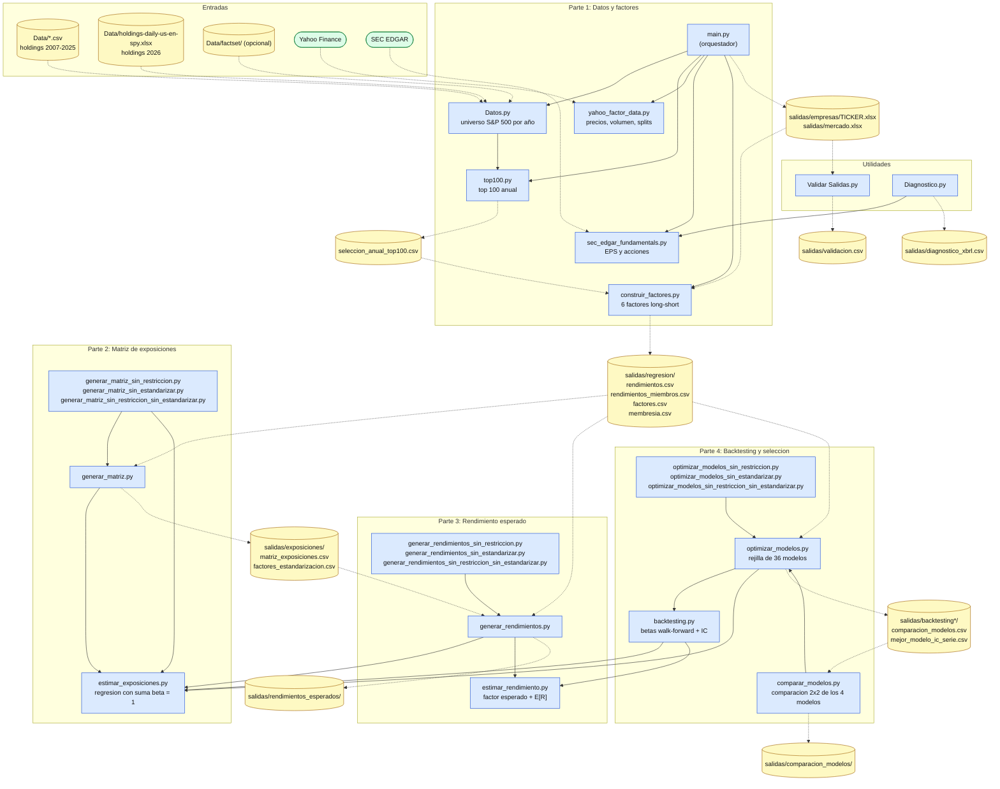

# PAP_IPEJAL_2: diagrama de conexiones entre archivos

Las flechas continuas (`-->`) son `import` entre scripts. Las flechas punteadas (`-.->`) son archivos de datos que se leen o se escriben. Las variantes `sin_restriccion` y `sin_estandarizar` van agrupadas en un solo nodo por etapa.

## Leyenda

| Color | Significado |
|---|---|
| Azul | Scripts `.py` |
| Amarillo | Archivos de datos (entradas y salidas) |
| Verde | Fuentes externas (Yahoo Finance, SEC EDGAR) |

## Orden de ejecución

1. `python main.py` (Parte 1)
2. `python generar_matriz.py` (Parte 2)
3. `python generar_rendimientos.py` (Parte 3)
4. `python optimizar_modelos.py` (Parte 4), más las variantes para los modelos 2, 3 y 4
5. `python comparar_modelos.py` (compara los 4 modelos)
